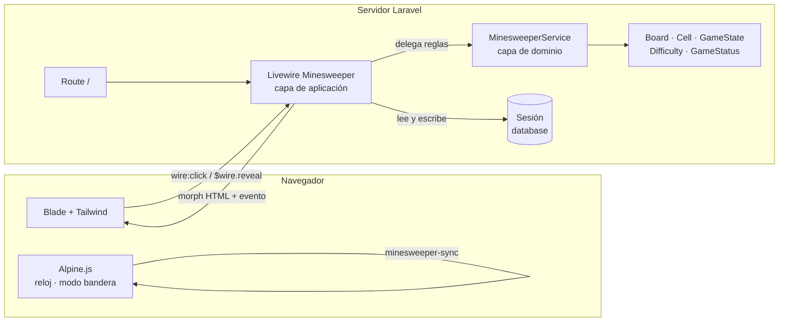
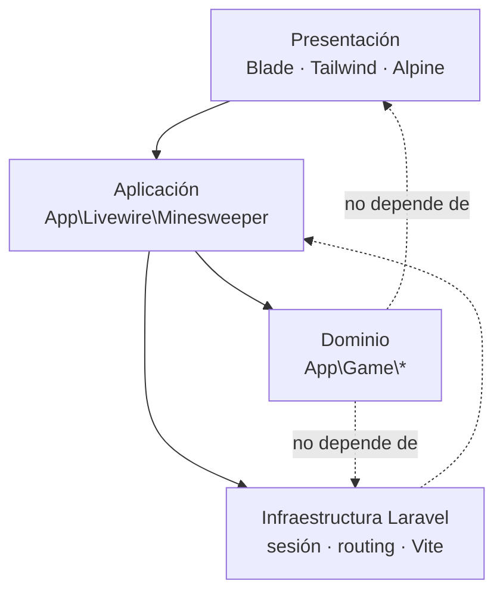
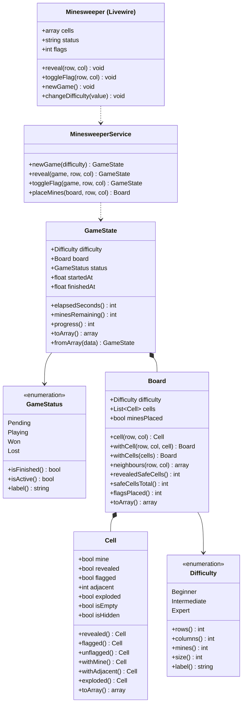
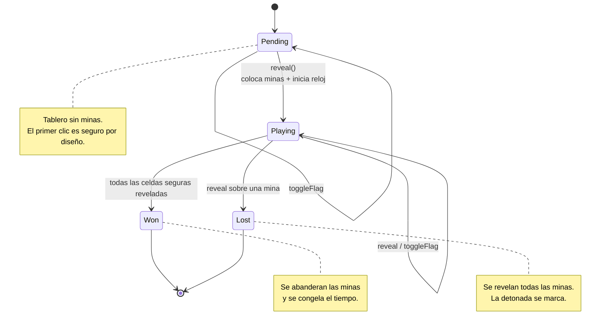
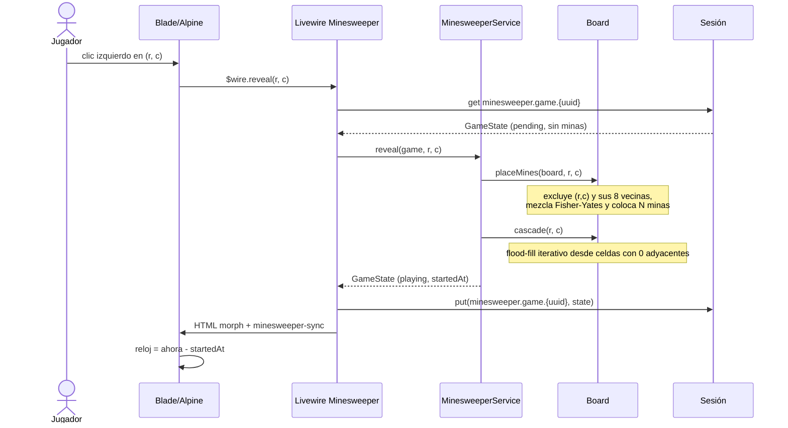
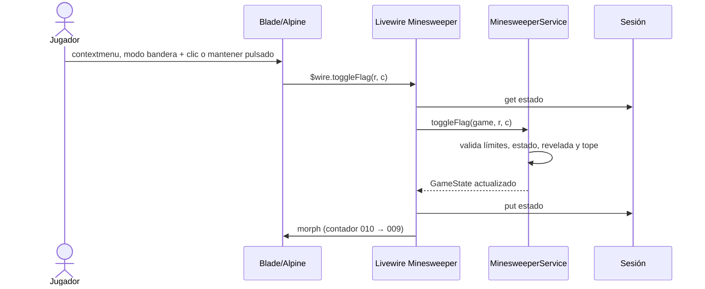

# Arquitectura del proyecto

Documento técnico del Buscaminas: capas, modelo de dominio, flujos, persistencia,
algoritmos, seguridad, pruebas y decisiones de diseño.

- **Stack**: Laravel 13.43 · Livewire 4.4.9 · PHP 8.5 · Tailwind 4 · Alpine 3
- **Estilo**: monolito modular *server-authoritative* (el servidor manda)
- **Alcance**: juego individual, sin cuentas, sin base de datos de partidas

---

## 1. Visión general

El navegador nunca posee el tablero real. Solo recibe una representación saneada y
envía intenciones (`reveal`, `toggleFlag`). El servidor reconstruye el estado desde la
sesión, aplica las reglas y devuelve el HTML actualizado.



Consecuencias directas:

- Inspeccionar el DOM o el payload de Livewire **no revela minas**.
- Cambiar props desde la consola no altera la partida (`#[Locked]` + recálculo).
- Cada acción es atómica: una petición Livewire = una jugada validada.
- La UI es HTML renderizado en servidor; Alpine solo gestiona el reloj, el selector
  de modo y la pulsación larga.

---

## 2. Objetivos y restricciones

| Objetivo | Cómo se cumple |
| --- | --- |
| Primer clic siempre seguro | Las minas se colocan después del primer clic, excluyendo su vecindario 3×3 |
| Lógica no manipulable | Estado real en sesión; el cliente solo manda coordenadas |
| Reactividad sin recargar | Livewire morph + Alpine |
| Tres dificultades exactas | Enum `Difficulty` como única fuente de verdad |
| Código testeable | Dominio sin dependencias de Laravel |
| PHP 8.5 real | `readonly`, `private(set)`, hooks, enums, `#[\NoDiscard]`, pipe `\|>` |

Restricción de diseño: **no persistir partidas**. Son efímeras y viven en la sesión.
Eso simplifica el modelo y refuerza el aislamiento, a cambio de no poder reanudar tras
un refresco o desde otro dispositivo.

---

## 3. Capas y reglas de dependencia



| Capa | Namespace / archivos | Puede depender de | No puede depender de |
| --- | --- | --- | --- |
| Dominio | `App\Game` | PHP estándar | Laravel, Livewire, HTTP, sesión |
| Aplicación | `App\Livewire` | Dominio + Laravel/Livewire | Detalles de Blade/CSS |
| Presentación | `resources/views`, `resources/js`, `resources/css` | Props públicas del componente | Reglas de negocio |

Regla práctica: `App\Game` se puede copiar a otro framework y seguiría funcionando.
Solo importa clases de `App\Game`.

La vista consume datos ya calculados (`$difficultyLabel`, `$statusLabel`, `$cells`,
`$flags`, etc.). No consulta el dominio ni la sesión.

---

## 4. Estructura de archivos

```
app/
├── Game/                              # Dominio puro
│   ├── Enums/
│   │   ├── Difficulty.php             # 67 líneas
│   │   └── GameStatus.php             # 39 líneas
│   ├── ValueObjects/
│   │   ├── Cell.php                   # 126 líneas
│   │   ├── Board.php                  # 206 líneas
│   │   └── GameState.php              # 174 líneas
│   └── Services/
│       └── MinesweeperService.php     # 250 líneas
└── Livewire/
    └── Minesweeper.php                # 208 líneas

resources/
├── css/app.css                        # 210 líneas: tema + tablero
├── js/app.js                          # 54 líneas: reloj Alpine
└── views/
    ├── layouts/app.blade.php
    └── livewire/minesweeper.blade.php # 187 líneas

routes/web.php                         # 1 ruta
tests/
├── Unit/MinesweeperServiceTest.php    # 339 líneas
└── Feature/
    ├── MinesweeperComponentTest.php   # 174 líneas
    └── ExampleTest.php                # smoke test de portada
```

### Mapa de lectura recomendado

1. `Difficulty` y `GameStatus` → vocabulario.
2. `Cell` → unidad inmutable.
3. `Board` → geometría y vecinos.
4. `GameState` → estado + cronómetro.
5. `MinesweeperService` → reglas.
6. `Livewire\Minesweeper` → orquestación y saneado.
7. Vista y `app.js` → interacción.

---

## 5. Modelo de dominio



### 5.1 `Difficulty`

Fuente única de dimensiones. Evita constantes repartidas por el código.

| Caso | `value` | Filas | Columnas | Minas | Celdas |
| --- | --- | ---: | ---: | ---: | ---: |
| Beginner | `beginner` | 8 | 8 | 10 | 64 |
| Intermediate | `intermediate` | 16 | 16 | 40 | 256 |
| Expert | `expert` | 16 | 30 | 99 | 480 |

> El nivel Experto es **30 columnas × 16 filas**, tal como pide la especificación.

### 5.2 `Cell`

- No es `readonly` porque usa *property hooks* (PHP no permite hooks en propiedades
  readonly), pero `private(set)` impide mutarla desde fuera.
- Todos los cambios devuelven un clon con el campo modificado.
- `isEmpty` es virtual: `!mine && adjacent === 0`. No se serializa.
- `#[\NoDiscard]` obliga a asignar el resultado; si se ignora, PHP avisa.

### 5.3 `Board`

- Lista plana `cells`; índice `row * columns + column`.
- Ventajas frente a matriz: menos memoria, acceso O(1), serialización directa y
  `foreach` sin anidar.
- Los vecinos se calculan con 8 offsets y se filtran por límites.
- No conoce minas “ocultas” para la vista: solo estado real.

### 5.4 `GameState`

- Inmutable y serializable.
- Guarda `startedAt`/`finishedAt` como `float` de `microtime(true)`.
- `elapsedSeconds()` se congela al terminar.
- `progress()` = celdas seguras reveladas / total seguro, 0..100.
- `minesRemaining()` = minas − banderas (nunca negativo).

---

## 6. Ciclo de vida de una partida



Estados terminales: cualquier acción posterior devuelve el mismo estado (no-op).
Esto se valida en `MinesweeperService::reveal()` y `toggleFlag()`.

---

## 7. Flujos principales

### 7.1 Primer clic



### 7.2 Bandera (clic derecho, selector o pulsación larga)



### 7.3 Fin de partida

- **Victoria**: al revelar la última celda segura, `settle()` abandera las minas y
  marca `Won`. El reloj se congela con `finishedAt`.
- **Derrota**: `detonate()` revela todas las minas, marca la pulsada con `exploded` y
  pasa a `Lost`. Las banderas incorrectas se muestran como ❌.

El componente calcula `wrongFlag` solo en derrota:

```php
'wrongFlag' => $lost && $cell->flagged && ! $cell->mine,
```

---

## 8. Persistencia y datos

### 8.1 Clave de sesión

```
minesweeper.game.{uuid v4}
```

- `gameId` se genera en `mount()` con `Str::uuid()`.
- Cada revancha o cambio de dificultad genera un UUID nuevo y **elimina** la clave
  anterior (`session()->forget()`), evitando que la sesión crezca.
- Pestañas distintas tienen UUID distintos y no comparten tablero.
- El cliente puede ver el UUID, pero no puede modificarlo (`#[Locked]`), y adivinarlo
  no sirve: la sesión viaja en una cookie HttpOnly.

### 8.2 Formato serializado

```json
{
  "difficulty": "expert",
  "status": "playing",
  "started_at": 1795456800.1234,
  "finished_at": null,
  "board": {
    "difficulty": "expert",
    "mines_placed": true,
    "cells": [
      { "m": false, "r": true,  "f": false, "a": 2, "x": false },
      { "m": true,  "r": false, "f": false, "a": 0, "x": false }
    ]
  }
}
```

| Clave | Significado |
| --- | --- |
| `m` | Tiene mina |
| `r` | Revelada |
| `f` | Bandera |
| `a` | Minas adyacentes (0..8) |
| `x` | Mina detonada |

`Board::fromArray()` descarta elementos no-array, y si el número de celdas no coincide
con la dificultad, reinicia el tablero. `GameState::fromArray()` valida enums con
`tryFrom()` y cae a valores seguros. Es una defensa ante sesiones corruptas o
manipuladas fuera del flujo normal.

### 8.3 Sesión frente a base de datos

| Criterio | Sesión (elegido) | Tabla de partidas |
| --- | --- | --- |
| Esquema/migraciones | Ninguno | Tabla + modelo |
| Reanudar tras refresco | No | Sí |
| Varias pestañas | Aisladas por UUID | Requiere id de partida |
| Aislamiento por navegador | Natural | Requiere usuario o token |
| Complejidad | Baja | Media |
| Anti-trampas | Estado en servidor | Igual |

Para un juego individual y efímero, la sesión gana en simplicidad sin perder seguridad.

---

## 9. Algoritmos

### 9.1 Colocación de minas (primer clic seguro)

1. Se construye el conjunto prohibido: celda pulsada + sus 8 vecinas.
2. Se generan todos los índices `0..n-1` y se restan los prohibidos.
3. Se mezclan con Fisher-Yates usando `random_int()`.
4. Se toman las primeras `mines` posiciones y se marcan.
5. Se recalcula `adjacent` para cada celda segura recorriendo sus vecinos.

**Por qué el primer clic siempre es seguro:** las minas no existen hasta ese momento y
la celda pulsada está excluida. Además, como todas sus vecinas también están excluidas,
su contador de adyacencia es necesariamente `0`, así que **siempre** dispara el desborde
y abre una zona (mínimo la propia celda y sus vecinas válidas).

Complejidad: `O(n)` con `n = filas × columnas` (la adyacencia son 8 comprobaciones por
celda). Para Experto, `n = 480`.

### 9.2 Desborde (flood fill) iterativo

El "desborde" es la expansión automática desde una celda sin minas adyacentes:

```
stack = [(r, c)]
mientras stack no vacío:
    (r, c) = pop
    si revelada, bandera o mina: continuar
    revelar
    si adjacent > 0: continuar      # celda con número: frena el desborde
    para cada vecina no revelada y sin bandera: push
```

- Sin recursión: evita desbordar la pila de llamadas y mantiene el coste controlado.
- Cada celda se revela como máximo una vez → `O(n)`.
- Las banderas bloquean la expansión (comportamiento clásico).
- Un clic en una celda con `adjacent > 0` solo destapa esa celda.

### 9.3 Victoria y derrota

| Evento | Acción |
| --- | --- |
| `revealedSafeCells == safeCellsTotal` | Abanderar minas restantes, `Won`, `finishedAt` |
| Mina revelada | Revelar todas las minas, marcar `exploded`, `Lost`, `finishedAt` |

Se comprueba la victoria **después** de cada revelado, nunca tras poner una bandera
(las banderas no revelan información). Una partida terminada es inmutable.

### 9.4 Banderas

- Solo en celdas no reveladas y con partida no terminada.
- Tope: `flagsPlaced < mines`. No se permiten más banderas que minas.
- Contador mostrado: `mines - flagsPlaced` (nunca negativo).
- Se permite abanderar antes del primer clic; si esa celda acaba siendo mina, la
  bandera era correcta por casualidad. Si se intenta revelar una celda con bandera,
  la acción se ignora.

### 9.5 Complejidad

| Operación | Coste |
| --- | --- |
| `newGame` | `O(n)` (crear celdas) |
| `reveal` + colocación | `O(n)` |
| `cascade` | `O(n)` |
| `toggleFlag` | `O(1)` |
| `serialize` / `hydrate` | `O(n)` |
| Render Livewire | `O(n)` (máx. 480 botones) |

---

## 10. Seguridad y anti-trampas

| Amenaza | Mitigación |
| --- | --- |
| Ver minas en DevTools | `mine` solo es `true` cuando `status === lost`; el resto se envía `false` |
| Modificar `cells`/`status` desde el cliente | `#[Locked]` + el siguiente render recalcula desde la sesión |
| Coordenadas fuera del tablero | `Board::contains()` en cada acción |
| Repetir clics o jugar tras terminar | Validación de `revealed`, `flagged` y `isFinished` |
| CSRF | Middleware de Laravel + token de Livewire |
| Robo de sesión | Cookie `HttpOnly`, `SameSite=Lax` (config por defecto) |
| Minas predecibles | Fisher-Yates con `random_int()` |
| XSS | Salida escapada por Blade, sin `{!! !!}` |
| Inflar la sesión | UUID nuevo + `forget()` de la partida anterior |
| Sesión corrupta | `fromArray()` valida enums, tipos y número de celdas |

Matiz importante: el jugador puede invocar `reveal` sobre cualquier celda (es su
tablero), pero eso no le da ventaja: no conoce las minas y la victoria exige revelar
todas las celdas seguras. Las minas **no viajan al cliente** antes de perder.

---

## 11. Frontend y reactividad

### 11.1 Componente Livewire

- Props derivadas y `#[Locked]`: `cells`, `status`, `flags`, `elapsed`, `progress`,
  `startedAtMs`, `finishedAtMs`.
- `syncView()` es el **único** punto que transforma dominio → presentación.
- `persist()` hace tres cosas en orden: guardar en sesión, sincronizar props y emitir
  `minesweeper-sync`.

Evento enviado al navegador:

```php
$this->dispatch(
    'minesweeper-sync',
    startedAt: $game->startedAtMs(),
    finishedAt: $game->finishedAtMs(),
    status: $game->status->value,
    elapsed: $game->elapsedSeconds(),
);
```

### 11.2 Reloj

- PHP calcula `startedAt`/`finishedAt` con `microtime(true)` y los envía en milisegundos.
- Alpine interpola cada 250 ms entre respuestas (`now - startedAt`).
- Al terminar, `finishedAt > 0` congela el reloj con el valor oficial.
- No se usa `wire:poll`: sería una petición por segundo sin aportar precisión.

### 11.3 Interacción

| Acción | Implementación |
| --- | --- |
| Revelar | Selector "Descubrir" + clic → `handleClick()` → `$wire.reveal(r, c)` |
| Bandera (ratón) | `x-on:contextmenu.prevent` → `handleContextMenu()` → `$wire.toggleFlag(r, c)` |
| Modo bandera (móvil) | Selector "Bandera": `handleClick()` llama a `toggleFlag()` |
| Pulsación larga | `pointerdown` 450 ms en táctil/lápiz → `toggleFlag()`; el clic posterior se suprime |
| Reiniciar | Botón sonriente `wire:click="newGame"` |
| Dificultad | `wire:click="changeDifficulty('expert')"` |

### 11.4 Render y estilos

- Un botón por celda con `wire:key` estable (`cell-{row}-{col}`) para que el morph no
  pierda el foco ni el estado.
- El tablero usa `display: grid` con `--cols`; el tamaño de celda se ajusta por nivel y
  viewport.
- Números con colores clásicos (`data-n="1"`…`"8"`).
- Estados visuales: oculta, revelada, bandera, mina, detonada, bandera incorrecta.
- En modo bandera, `mine-board--flag` tiñe de ámbar las celdas ocultas para que el
  cambio de modo sea evidente antes de tocar.
- Responsive: scroll horizontal en Experto dentro de `.overflow-x-auto`.
- Accesibilidad: `aria-label` por celda, `role="group"`, `role="progressbar"` con
  `aria-valuenow`, botones nativos y foco visible.

### 11.5 Sin estado duplicado

El frontend no guarda una copia autoritativa del tablero. `cells` es una proyección.
Alpine solo guarda estado de UI: el instante actual del reloj, `flagMode` y el
temporizador de pulsación larga. Cualquier divergencia se corrige en la siguiente
respuesta de Livewire.

---

## 12. Pruebas

### 12.1 Unitarias (`tests/Unit/MinesweeperServiceTest.php`)

No arrancan Laravel; instancian el servicio directamente.

- Partida nueva: `pending`, sin minas, 10 restantes, 64 celdas.
- Primer clic seguro en los tres niveles: sin mina, todas colocadas, desborde ≥ 9.
- Adyacencia correcta en todas las celdas.
- El desborde expande todas las vecinas de una celda vacía.
- Desborde determinista: 10 minas en el borde → revela exactamente la región
  conectada (54 celdas seguras), sin revelar ninguna mina.
- Banderas: alternar, tope de 10, no revelar una celda abanderada.
- Coordenadas fuera de rango: no-op.
- Victoria: 100 % de progreso, minas abanderadas, estado inmutable.
- Derrota: todas las minas reveladas, celda detonada marcada.
- Round-trip de serialización JSON.
- Inmutabilidad de `Cell`.

### 12.2 Integración (`tests/Feature/MinesweeperComponentTest.php`)

Usan `Livewire::test()` y la sesión de test.

- Render inicial y props por defecto.
- Primer `reveal` inicia la partida y **ninguna celda revelada tiene `mine = true`**.
- Contador de banderas 10 → 9 → 10.
- Cambio a Experto: 16×30, 99 minas, 480 celdas, estado `pending`.
- Dificultad inválida: ignorada.
- Coordenadas inválidas: no rompen el estado.
- Evento `minesweeper-sync` emitido.
- Victoria: banner “Tablero despejado”.
- Derrota: banner “Pisaste una mina” y 10 minas visibles.

### 12.3 Smoke test

`tests/Feature/ExampleTest.php` comprueba que `/` responde 200 (incluye compilación de
assets).

Total: **24 tests**. Ejecución:

```bash
php artisan test
./vendor/bin/pint
```

---

## 13. Decisiones y trade-offs

| Decisión | Alternativa | Por qué se eligió |
| --- | --- | --- |
| Sesión como almacén | Tabla `games` | Cero esquema, aislamiento natural, partidas efímeras |
| Lista plana de celdas | Matriz `[row][col]` | Índice O(1), serialización simple, menos anidamiento |
| Objetos inmutables | Mutación in-place | Menos bugs, fácil comparar y testear |
| Desborde iterativo | Recursión | Evita límites de pila y es O(n) |
| UUID por partida | Clave fija `minesweeper.game` | Varias pestañas y revanchas sin colisiones |
| Livewire | API + SPA | El estado no sale del servidor |
| Alpine para el reloj | `wire:poll` | Sin peticiones por segundo; PHP sigue mandando |
| Tope de banderas | Contador negativo clásico | Evita banderas absurdas y simplifica la UI |
| Emojis | Iconos SVG | Cero dependencias y legible en cualquier plataforma |
| Tailwind 4 CSS-first | `tailwind.config.js` | Menos archivos y configuración |

---

## 14. Puntos de extensión

### Añadir una dificultad

Solo hay que añadir un caso al enum y sus ramas `match`:

```php
case Nightmare = 'nightmare';

// rows(), columns(), mines(), label() ...
```

La UI se genera con `Difficulty::cases()`, así que aparece automáticamente. Condición:
`mines <= size - 9` para que el vecindario del primer clic siempre quepa.

### Otras mejoras

| Función | Dónde encajaría |
| --- | --- |
| Chording (clic central) | Nuevo método `chord()` en el servicio |
| Mejores tiempos | Tabla `scores` + `Cache`; el servicio no cambia |
| Reanudar partida | Cambiar sesión por tabla `games` con id público |
| Multijugador | Broadcasting + validación de turnos e idempotencia |
| Pistas / deshacer | Guardar snapshots de `GameState` (ya es inmutable) |
| i18n | Mover labels de enums a `lang/` |
| Sonidos | Eventos Livewire + Web Audio en Alpine |

---

## 15. Limitaciones conocidas

- Refrescar la página reinicia la partida (no hay reanudación).
- La partida vive en la sesión del navegador; no se comparte entre dispositivos.
- No hay chording, pistas, deshacer ni ranking.
- El tope de banderas impide el contador negativo del Buscaminas de Windows.
- Los emojis dependen de la fuente del sistema operativo.
- El tablero Experto puede requerir scroll horizontal en móviles.
- Sin rate limiting específico: el volumen de acciones es el de un jugador humano.

---

## 16. Operación

### Desarrollo

```bash
composer install
cp .env.example .env
php artisan key:generate
touch database/database.sqlite
php artisan migrate
npm install
npm run dev        # o: npm run build
php artisan serve
```

### Producción

```bash
npm run build
php artisan migrate --force
php artisan config:cache
php artisan route:cache
php artisan view:cache
```

Configuración recomendada: `APP_ENV=production`, `APP_DEBUG=false`, HTTPS y
`SESSION_SECURE_COOKIE=true`.
